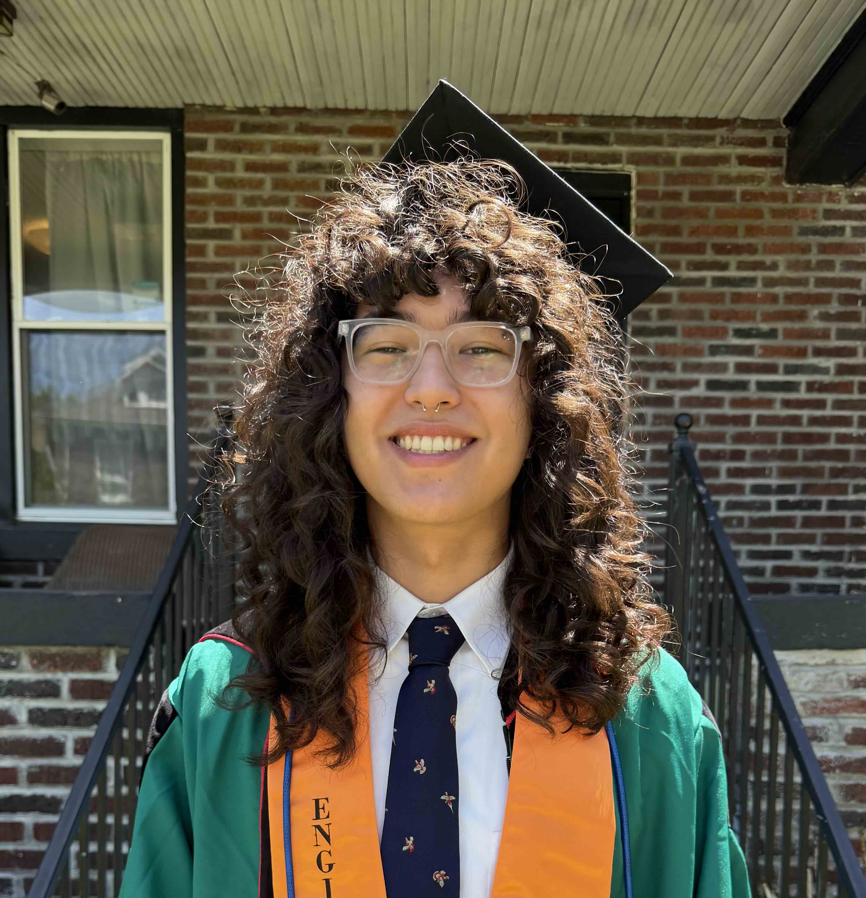

I'm Francis, a master's student in biostatistics at Columbia University. I graduated from Washington University in St. Louis, where I studied Computer Science and Mathematics with a minor in Philosophy. 

I'm interested in data science, machine learning, specifically their applications to public health and real-world decision-making. This website includes some of my data science projects and visualizaitons. 

To see my resume, go [here](resume.html)

To see my dashboard, go [here](restaurant_dashboard.html)

